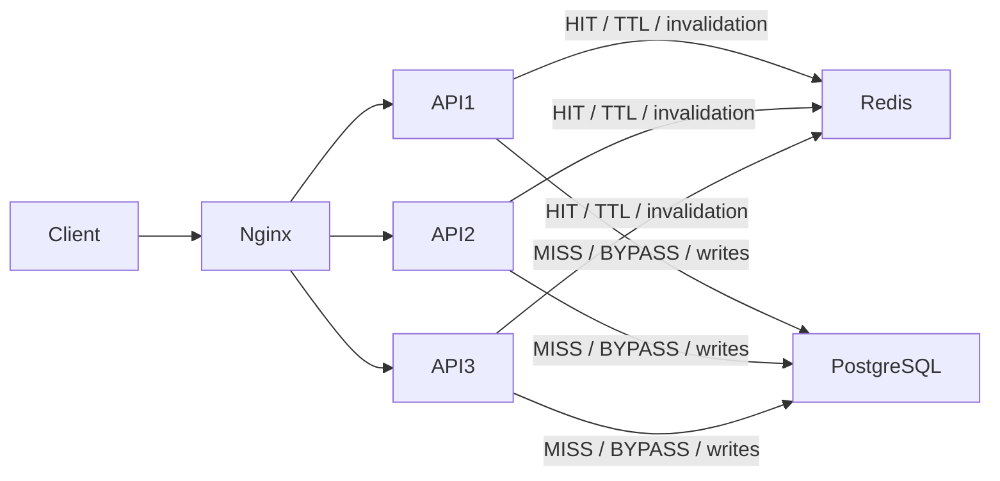

# Лабораторна робота №4 — Розподілене кешування

Для публічної статистики продажів реалізовано Cache-Aside: три екземпляри License Service використовують спільний Redis, а PostgreSQL залишається джерелом даних. Кеш зменшує повторні обчислення; API-зміни інвалідують його.

## Запуск середовища

Команди для **Windows CMD**, послідовно в одному вікні. Потрібні Docker Desktop у режимі Linux containers, Docker Compose 2.24.4+ і Python 3.12+. На іншому ПК контейнери створюються заново; production `.env` не потрібний. Інші навантажувальні стенди мають бути зупинені.

```cmd
cd /d C:\MTGMODS\labs-license-management-platform
set "LABPY=python"
if exist ".venv\Scripts\python.exe" set "LABPY=.venv\Scripts\python.exe"
"%LABPY%" --version
docker info --format "OS={{.OSType}}"
set "LAB4_CACHE_ENABLED=true"
set "LAB4_CACHE_TTL_SECONDS=300"
set "DC4=docker compose -p mtgmods_distributed_cache_lab4 -f docker-compose.scaling.yml -f docker-compose.cache.yml"
%DC4% build license-db-init
%DC4% up -d --wait --wait-timeout 180
%DC4% up -d --no-deps --force-recreate scaling-gateway
%DC4% run --rm -T --no-deps cache-tools < NUL
```

Створюються 2000 синтетичних ліцензій і покупок. Повторний seed не дублює дані. Адреса стенда — `http://127.0.0.1:18104`.

## 2.1. Аналіз та вибір об'єкта кешування

Обрано `GET /api/v1/license/stats/public`: однакова для всіх статистика доходу, тарифів та історії продажів. Читання повторюються частіше за покупки; один розрахунок містить 11 бізнес-SELECT з агрегаціями. Без мутацій допустимий вік кешу — 300 s, після API-зміни потрібен новий результат.

**Код:** [repository.py:154](../services/license/app/infrastructure/repository.py#L154), `get_heavy_public_stats`. Авторизація та перевірка VIP не кешуються цим механізмом.

## 2.2. Інтеграція розподіленого Cache Storage

Redis — окремий контейнер у спільній мережі. Усі три API мають однаковий `REDIS_URL`; Nginx розподіляє HTTP-запити Round Robin. Конфігурація — [docker-compose.cache.yml](../docker-compose.cache.yml) поверх [docker-compose.scaling.yml](../docker-compose.scaling.yml).

```cmd
%DC4% ps
%DC4% exec -T redis redis-cli PING < NUL
```

Результат: три healthy API та `PONG` від Redis.



## 2.3. Реалізація Cache-Aside

**HIT:** готовий JSON повертається з Redis без SQL. **MISS:** сервіс рахує статистику в PostgreSQL, записує JSON з TTL і повертає його. Реалізація — [cache_aside.py:115](../services/license/app/infrastructure/cache_aside.py#L115), `_read_loop`.

```cmd
%DC4% exec -T redis redis-cli DEL mtgmods:license:public_stats:v2 < NUL
curl.exe -sS -D - -o NUL http://127.0.0.1:18104/api/v1/license/stats/public
curl.exe -sS -D - -o NUL http://127.0.0.1:18104/api/v1/license/stats/public
```

Перший запит: `X-Cache: MISS`; другий: `HIT`. Різні `X-Instance-ID` підтверджують використання спільного кешу різними API.

## 2.4. Схема ключів та політика TTL

Ключ `mtgmods:license:public_stats:v2` містить проєкт, домен, ресурс і версію формату. Endpoint не має параметрів і не залежить від користувача, тому `id` та `params_hash` не потрібні. TTL — 300 s. Суфікси `:revision`, `:writers`, `:lock` використовуються для узгодження записів і розрахунків.

```cmd
%DC4% exec -T redis redis-cli TTL mtgmods:license:public_stats:v2 < NUL
```

Після заповнення значення від 0 до 300; `-2` означає відсутній ключ. Реальне завершення TTL перевіряється також у пункті 2.5.

## 2.5. Інвалідація після модифікуючих операцій

Middleware [main.py:85](../services/license/app/main.py#L85) обгортає API-записи. `begin_write` / `end_write` у [cache_aside.py:194](../services/license/app/infrastructure/cache_aside.py#L194) змінюють revision та видаляють JSON. Старий паралельний розрахунок не може опублікувати результат після мутації; незавершені записи переводять читання в `BYPASS`.

```cmd
"%LABPY%" scripts\highload-lab4\verify.py --samples 10 < NUL
```

[verify.py:45](../scripts/highload-lab4/verify.py#L45) виконує реальні API-запити: створення й активація покупки на $3 → PATCH до $7 → DELETE. Він перевіряє відповідні зміни доходу, `MISS` після кожної мутації та видалення ключа за TTL. Наприкінці виводяться `checks` і медіани 10 пар cold/hot. Тестова ліцензія видаляється, Redis відновлюється через `finally`; помилка перевірки завершує скрипт ненульовим кодом.

## 2.6. Метрики продуктивності та відмова Redis

Заголовки `X-Cache`, `X-Instance-ID`, `X-Cache-TTL`, `X-Cache-Invalidation` показують джерело відповіді й інвалідацію. У прогоні **13.10.2026** на ПК з 12 logical CPU та приблизно 16 GiB Docker RAM медіани становили **138.705 ms MISS / 53.913 ms HIT** — прискорення близько 2.57 раза. Сирі значення — [highload-lab4.json](results/highload-lab4.json); новий запуск вище вимірює поточний ПК окремо.

```cmd
%DC4% stop redis
curl.exe -sS -D - -o NUL http://127.0.0.1:18104/api/v1/license/stats/public
%DC4% start redis
curl.exe -sS -D - -o NUL http://127.0.0.1:18104/api/v1/license/stats/public
```

При відмові: `200 OK`, `X-Cache: BYPASS`, читання напряму з БД. Після відновлення кеш заповнюється знову. Strict-записи під час відмови отримують `503` до зміни БД: без Redis неможливо гарантувати координацію інвалідації.

## Висновки та межі реалізації

Cache-Aside розвантажує БД, TTL обмежує вік результату, інвалідація забезпечує актуальність після API-мутацій. Прямі SQL-зміни цей протокол не проходять. Після аварії посеред запису може залишитися writer-маркер і `BYPASS`; його очищення допустиме лише після зупинки writers і перевірки транзакцій. Це не спільна транзакція Redis + PostgreSQL.

Expiration — завершення TTL; invalidation — скидання через зміну даних. LRU витісняє давно не використані, LFU — рідко використані ключі; окреме eviction tuning тут не налаштоване. Stampede — одночасний перерахунок одного ключа; avalanche — одночасне завершення багатьох; thundering herd — хвиля звернень до залежності. Lua у Redis лише атомарно координує кеш; продажі рахуються SQL/Python.

Зупинка лише цього стенда, без видалення тому БД:

```cmd
%DC4% down
```
