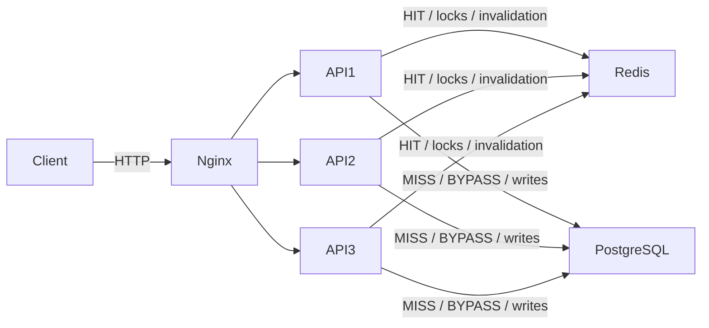

# ІВСАВПЗ Лабораторна робота №4

## Тема та результат

Розподілене кешування та патерни узгодженості даних. На основі стенда №3
реалізовано строгий Cache-Aside для публічної статистики License Service.
Три instances використовують один Redis. Гарячий запит не звертається до БД;
холодний обчислює статистику, зберігає JSON з TTL і повертає результат.
Мутації інвалідують кеш, а недоступність Redis не блокує читання статистики.

Це окремий лабораторний режим `STATS_CACHE_ASIDE=true`. Без цього прапорця
стенди №2, №3, Kubernetes і Helm зберігають попередній SWR-кеш. Usage Service
не змінений. Лабораторна №5 та часткова №8 не входять у цю роботу.

## 2.1 Вибір об’єкта кешування

Endpoint: `GET /api/v1/license/stats/public`.

Репозиторій агрегує продажі, дохід, активні підписки, способи оплати, тарифи,
історію за днями/місяцями, повторні покупки та старі безстрокові ліцензії.
Один розрахунок виконує декілька SQL-запитів із JOIN, DISTINCT і GROUP BY,
а також формує список продажів. Вартість зростає разом із dataset.

Це read-intensive сценарій: відвідувачі можуть багаторазово читати ті самі
відкриті цифри, тоді як покупки та адміністративні зміни відбуваються рідше.
Без нових записів допустиме оновлення агрегатів раз на 300 секунд.
Після завершеної API-мутації потрібне свіже читання, тому одного TTL недостатньо.
Перевірка права на VIP та авторизація не використовують цей кеш.

## 2.2 Розподілене сховище та архітектура

`docker-compose.cache.yml` накладається на `docker-compose.scaling.yml`.
Він задає окремий project `mtgmods_distributed_cache_lab4`, окрему мережу,
окремий volume PostgreSQL і gateway на `127.0.0.1:18104`.
Backend і Redis не мають зовнішніх портів. Усі instances мають той самий
`REDIS_URL`, той самий ключ і повертають `X-Instance-ID`.
Overlay фіксує Round Robin незалежно від залишеної у shell змінної
`SCALING_UPSTREAM_CONFIG` із попередньої лабораторної.

Схема: [architecture-c4-distributed-cache.mmd](architecture-c4-distributed-cache.mmd).



Тарифи, боти, frontend, User Service та RabbitMQ не потрібні для демонстрацій
цього сценарію. Expiry worker вимкнений: фонові або сторонні записи поза
протоколом інвалідації не повинні змінювати dataset. Strict-режим відмовляється
стартувати з увімкненим вбудованим expiry worker.

## 2.3 Cache-Aside та Request Flow

Реалізація: `services/license/app/infrastructure/cache_aside.py`.

1. Lua атомарно читає revision, JSON і кількість незавершених writers.
2. Коректний JSON без writers означає HIT: повертається без SQL.
3. Відсутній, прострочений або пошкоджений JSON означає cache miss.
4. Instance отримує Redis lock через `SET NX EX`, повторно перевіряє кеш
   та виконує реальний `LicenseRepository.get_heavy_public_stats()`.
5. Lua публікує результат лише якщо token блокування та revision досі збігаються
   й немає незавершених writers. JSON має реальний Redis TTL.
6. Якщо під час розрахунку сталася інвалідація, старий результат відкидається.
   Запит повторно читає/обчислює актуальні дані замість публікації старого snapshot.

Інші instances чекають на спільний результат, а не створюють локальні кеші.
Generation і загальний request timeout — 90 секунд; lease блокування — 120 секунд.
Очікування зайнятого ключа обмежене, після вичерпання повертається 503
з `Retry-After: 2`. Gateway цього стенда має timeout 100 секунд, довший за
application timeout. Повторні розрахунки через інвалідацію також обмежені
загальним deadline. Помилка публікації в Redis не запускає вже завершений
SQL-розрахунок удруге. Це лабораторні межі, не production SLO.

Зняття блокування перевіряє token: старий власник не може видалити lock
нового worker. У цьому режимі немає SWR чи фонової публікації старих даних.

## 2.4 Ключі та TTL

- `mtgmods:license:public_stats:v2` — весь публічний JSON, TTL 300 секунд.
- `mtgmods:license:public_stats:v2:revision` — номер покоління інвалідації,
  без TTL; захищає від публікації старого розрахунку.
- `mtgmods:license:public_stats:v2:lock` — token обчислення, TTL 120 секунд.
- `mtgmods:license:public_stats:v2:writers` — множина незавершених write-token,
  без TTL; її наявність забороняє довіряти кешу.

Namespace містить продукт, домен, об’єкт і версію контракту. Endpoint не має
фільтрів: усі часові розрізи знаходяться в одному JSON, він не залежить від JWT
або користувача. Тому user ID і params hash не потрібні. Якщо з’являться
server-side фільтри, їх треба включити в ключ, а не ділити цей ключ між різними
результатами. `v2` відділяє строгий JSON від попереднього SWR envelope `v1`.

TTL обмежує застарівання без мутацій. Invalidation є окремою дією після запису,
а не очікуванням завершення TTL. Тести підтверджують справжнє видалення ключа
після expiration; живий сценарій прискорює expiration до 1 секунди.

## 2.5 Інвалідація та узгодженість

Middleware обгортає HTTP POST/PUT/PATCH/DELETE у просторі `/api/v1/license/`.
Це консервативна інвалідація: також очищаються дані після операцій, які могли
не змінити статистику. При недоступному Redis write-запит отримує 503 ще
до виконання endpoint і не змінює БД.

Перед записом Lua додає унікальний write-token, збільшує revision і видаляє JSON.
Поки є хоча б один writer, читання йде до БД з `X-Cache: BYPASS`, без заповнення
кешу. Після завершення endpoint Lua ще раз збільшує revision, очищає JSON
і знімає лише власний token. Успішне завершення повертає
`X-Cache-Invalidation: INVALIDATED`. Наступне читання отримує MISS і свіжі цифри.

Інвалідація виконується і після відповіді з помилкою: endpoint міг частково
зафіксувати дані. Протокол захищає від гонки «старий loader → новий commit →
публікація старого JSON» і підтримує кілька конкурентних writers.

Якщо commit відбувся, але завершальне звернення до Redis не вдалося,
відповідь позначається `DIRTY`, а writer залишається у спільному Redis.
Після відновлення Redis читання залишається BYPASS: система не видає потенційно
застарілий кеш. Маркер не має автоматичного TTL, бо його завершення саме собою
не доводить завершення транзакції. Ціна безпеки — ручне відновлення кешування
після такого збою. Це не атомарна транзакція PostgreSQL+Redis.

Протокол поширюється на HTTP-операції стенда та seed-скрипт. Прямі SQL-зміни
або інший worker без цього протоколу не покриваються. Redis працює без persistence;
після втрати його пам’яті кеш холодний. Відновлення давнього Redis snapshot
разом із незавершеними DB-записами потребувало б durable DB outbox/versioning.

## 2.6 Метрики та перевірка збоїв

API повертає `X-Cache: MISS`, `HIT` або `BYPASS`, а також `X-Cache-Key`,
`X-Cache-TTL` і `X-Instance-ID`. Формат JSON публічного API не змінений.

Вимірювання від 13 жовтня 2026 року:

- Windows + Docker Desktop, Engine 29.2.1, 12 logical CPU, 16726044672 bytes RAM
  доступно Docker; окремих CPU/RAM limits для контейнерів не встановлено.
- PostgreSQL 16, Redis 7.4, Nginx 1.27; 3 API instances.
- 2000 синтетичних ліцензій і 2000 покупок; кешований JSON — 330168 bytes.
- 10 послідовних пар cold/hot після функціональної перевірки та прогріву пулів.
  Перед кожним cold видаляється лише JSON-ключ; Docker CLI overhead
  не входить у вимір HTTP. Cold тут означає холодний Redis, не холодний диск БД.
- Cold median — **138.705 ms**, Hot median — **53.913 ms**:
  приблизно 2.57 раза швидше, медіана затримки нижча приблизно на 61.1%.
- Перший MISS обробив `license-service-3`, наступний HIT — `license-service-1`.
- Після створення й активації дохід зріс на $3; після PATCH суми — на $7;
  після DELETE повернувся до початкового. У всіх трьох випадках перше читання — MISS.
- Після expiration — MISS. Після `docker stop redis` — 200/BYPASS,
  **608.361 ms**; новий write — 503 до запису. Після restart Redis — MISS.

Сирі значення та конфігурація: [results/highload-lab4.json](results/highload-lab4.json).
Це локальне cold/hot порівняння, не вимір stable RPS чи saturation.
Передавання та JSON-серіалізація залишаються навіть на HIT, тому він не стає
«безкоштовним». Повний load/performance baseline виконується окремо у №5.

## Відтворюваний запуск

З кореня лабового репозиторію, Docker Desktop у режимі Linux containers:

```powershell
$dc = @('-f', 'docker-compose.scaling.yml', '-f', 'docker-compose.cache.yml')
docker compose @dc up --build -d
docker compose @dc ps
docker compose @dc run --rm --no-deps cache-tools
```

Seed створює synthetic dataset лише за прапорцем `LAB4_DEMO=true` у tool-контейнері.
Повторний запуск не дублює його. Production `.env` не потрібні: використовуються
навчальні `.env.example`, не бойові ключі й не бойова БД.

Повна автоматична перевірка на хості потребує лише Python 3.12+ та Docker CLI;
додаткових pip-пакетів для `verify.py` не потрібно:

```powershell
python scripts/highload-lab4/verify.py --samples 10
```

Якщо Python доступний тільки у venv:

```powershell
.\.venv\Scripts\python scripts/highload-lab4/verify.py --samples 10
```

Скрипт приймає лише локальний порт 18104 і жорстко задає Lab 4 Compose project.
Він створює короткоживучий навчальний JWT, перевіряє POST/PATCH/DELETE,
видаляє власну тестову ліцензію, зупиняє/відновлює Redis через `finally`,
перевіряє відновлення та друкує JSON результатів без JWT.

## Окремі демонстраційні запити

### MISS та HIT через різні instances

```powershell
docker compose @dc exec -T redis redis-cli DEL mtgmods:license:public_stats:v2
1..2 | ForEach-Object {
    $r = Invoke-WebRequest http://127.0.0.1:18104/api/v1/license/stats/public
    "Instance=$($r.Headers['X-Instance-ID']); Cache=$($r.Headers['X-Cache'])"
}
docker compose @dc exec -T redis redis-cli TTL mtgmods:license:public_stats:v2
```

Очікується MISS, потім HIT, різні instance IDs і TTL не більше 300.
Для ручної інвалідації використовується quiescent-сценарій без паралельних writers;
звичайні мутації API застосовують revision-fenced протокол.

### Інвалідація через API

```powershell
$token = docker compose @dc exec -T license-service-1 python -c "import jwt; from datetime import datetime,timedelta,timezone; from app.shared.config import settings; print(jwt.encode({'sub':'1','role':'ADMIN','type':'access','exp':datetime.now(timezone.utc)+timedelta(minutes=15)},settings.JWT_SECRET,algorithm='HS256'))"
$headers = @{ Authorization = "Bearer $($token.Trim())" }
$new = Invoke-RestMethod -Method Post -Uri http://127.0.0.1:18104/api/v1/license/generate -Headers $headers -ContentType 'application/json' -Body '{"duration_days":30,"amount":3,"method":"Stars","max_devices":2,"reset_limit":0}'
$found = Invoke-RestMethod -Uri "http://127.0.0.1:18104/api/v1/license/find?key=$($new.data.key)" -Headers $headers
$licenseId = $found.data[0].id
Invoke-RestMethod -Method Patch -Uri "http://127.0.0.1:18104/api/v1/license/$licenseId" -Headers $headers -ContentType 'application/json' -Body '{"status":"ACTIVE","user_id":999999}'
$r = Invoke-WebRequest http://127.0.0.1:18104/api/v1/license/stats/public
$r.Headers['X-Cache']
($r.Content | ConvertFrom-Json).subscriptions.overview.total_money
Invoke-RestMethod -Method Delete -Uri "http://127.0.0.1:18104/api/v1/license/$licenseId" -Headers $headers
```

Після PATCH очікується MISS та врахування нової оплаченої підписки в доході.
Generate без власника ще не збільшує продажі підписок — це правило самого домену,
не помилка кешу. DELETE також інвалідує результат.

### Fallback та відновлення

```powershell
docker compose @dc stop redis
try {
    $r = Invoke-WebRequest http://127.0.0.1:18104/api/v1/license/stats/public
    $r.StatusCode
    $r.Headers['X-Cache']
} finally {
    docker compose @dc start redis
}
```

Очікується HTTP 200 і BYPASS; backend читає PostgreSQL, а не падає разом із кешем.
Помилка БД не маскується кешем: дані не вигадуються. Таймаути Redis — 0.5 s
на підключення/операцію, без автоматичних retry, що обмежує додаткову затримку.

### Відновлення після аварійно залишеного writer

Лише для ізольованого стенда та після завершення всіх seed/script процесів:

```powershell
docker compose @dc stop license-service-1 license-service-2 license-service-3
docker compose @dc exec -T redis redis-cli INCR mtgmods:license:public_stats:v2:revision
docker compose @dc exec -T redis redis-cli DEL mtgmods:license:public_stats:v2 mtgmods:license:public_stats:v2:writers mtgmods:license:public_stats:v2:lock
docker compose @dc up -d --no-deps license-service-1 license-service-2 license-service-3
```

Це очищення лише cache metadata, не PostgreSQL. Не можна знімати markers
при активних writers: спочатку треба виключити можливість пізнього commit.

## Перевірки коду

```powershell
.\.venv\Scripts\python -m pytest tests -q
.\.venv\Scripts\python -m ruff check services/license scripts/highload-lab4 tests/system/test_license_cache.py
```

Для Lab 4 додано 15 перевірок: shared HIT без loader, TTL, single-flight,
інвалідація під час розрахунку, dirty marker, кілька writers, fallback,
disabled cache, malformed JSON, loader error, втрата lease, bounded wait,
cancellation та HTTP-контракт із реальним записом у тестову SQLite БД.
Новий файл включений у license job наявного CI.
Підсумкова локальна перевірка: **149 Python-тестів пройшли**, Ruff і Compose
config validation також завершилися успішно.

## Пояснення патернів і меж

- Cache stampede — багато клієнтів одночасно перераховують один холодний ключ.
  Shared lock уже запобігає цьому; окремі 500+ VU експерименти залишені для №8.
- Thundering herd — хвиля конкурентних звернень до залежності, зокрема при MISS.
- Cache avalanche — одночасне expiration багатьох ключів. TTL jitter тут ще
  не реалізований; ця робота кешує один aggregate, а не множину entity keys.
- Expiration завершує життя ключа за часом; invalidation скидає його через зміну даних.
- Redis LRU/LFU обирають кандидата на eviction за давністю/частотою використання.
  Вони не замінюють TTL чи інвалідацію. Стенд використовує стандартну конфігурацію
  без спеціального maxmemory/eviction tuning; не стверджується, що LRU ввімкнений.
- Negative caching тут не реалізований: це інша частина №8, не вимога №4.
- Redis є SPOF для ефективності читання та доступності строгих write-операцій.
  Відмова кешу збільшує навантаження на PostgreSQL. Гарантія узгодженості обрана
  замість продовження записів без можливості координації інвалідації.

## Зупинення стенда

```powershell
docker compose @dc down
```

Без `-v`: синтетична БД зберігається. Ця команда не зупиняє проєкти №2/№3
або production і не видаляє їхні volumes.
