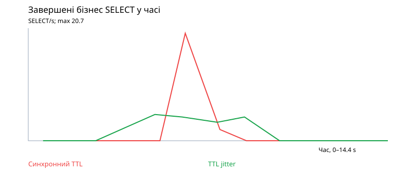
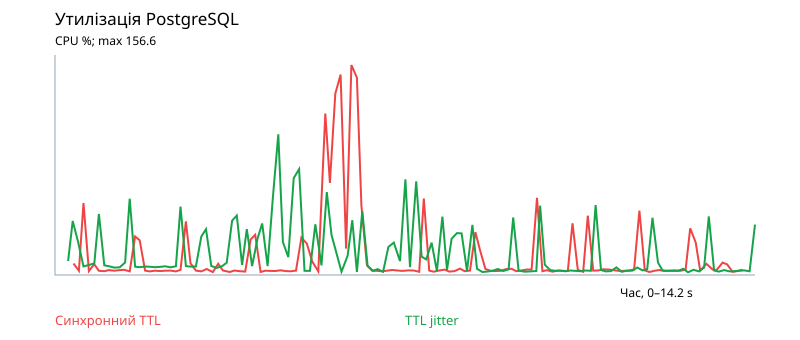
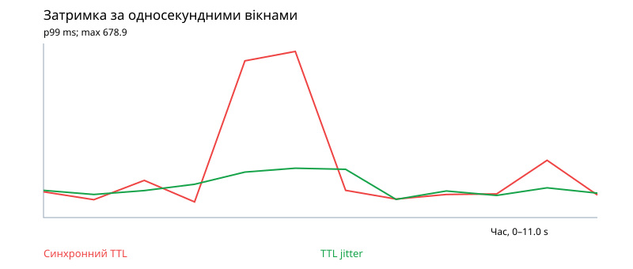
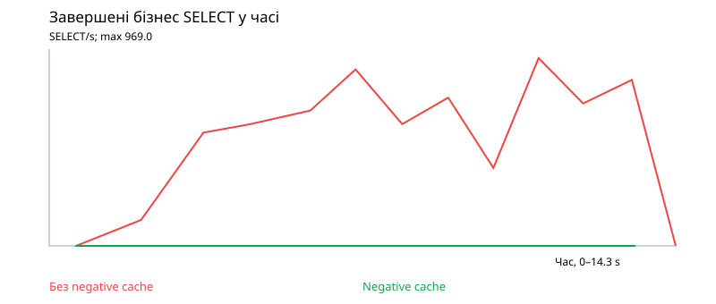
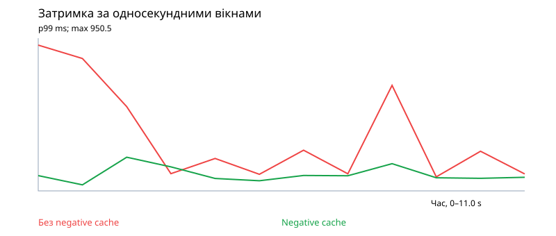
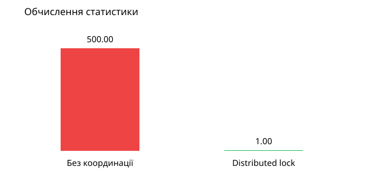
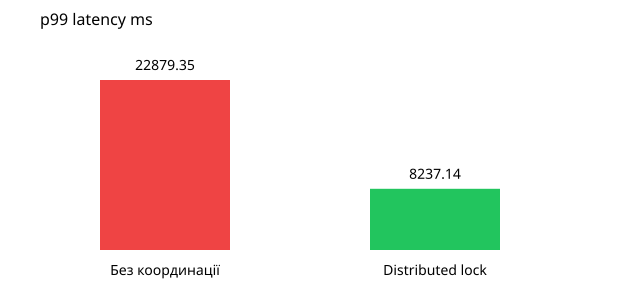
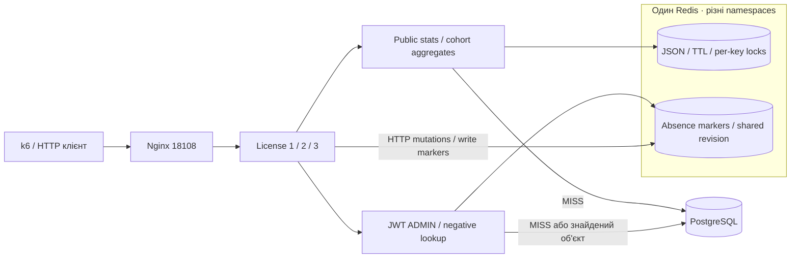

# ІВСАВПЗ №8 — технічні подробиці та початкові вимірювання

## Обсяг роботи

Після реалізованих №4 та №5 виконано всі пункти **2.1–2.7**:
Cache Stampede, Cache Avalanche, distributed lock, TTL jitter,
Negative Caching та кількісний аналіз механізмів захисту.
Експерименти проведені у реальних Docker-контейнерах із PostgreSQL, Redis і k6.
Синтетичні дані, додаткові затримки й SQL amplification явно позначені.
Реплікація й шардинг №6/№7 у цьому експерименті не потрібні технічно і не заявляються.

## 2.1 Ресурсоємний кешований об’єкт

Використано ту саму реальну статистику License Service, що у №4/№5:
`GET /api/v1/license/stats/public`, PostgreSQL з 2000 synthetic licenses/purchases.
При MISS виконується повний набір SQL-агрегацій і формується великий JSON.
Ключ популярного aggregate один на всі три instances, тому одночасний MISS
створює ризик багатьох однакових розрахунків.

Стенд окремий: `mtgmods_cache_resilience_lab8`, порт `127.0.0.1:18108`, власні
PostgreSQL/Redis, CPU/RAM та CPU sets із №5. Бойові дані й production не використовуються.

## 2.2 Відтворення Cache Stampede та Thundering Herd

`load-tests/stampede.js` створює **500 VUs, по одному запиту на кожен**.
Часова gate після setup дає VUs можливість підготуватися і звернутися одночасно,
а не поступово прогріти кеш. Перед кожним режимом очищається лише окремий lab Redis,
відновлюється тотожний dataset і скидаються SQL-лічильники.

Для контрольованого широкого MISS-вікна обидва режими мають однакову явно
синтетичну затримку **2000 ms перед реальним SQL**. Вона не замінює SQL і не
видається за властивість production. Її призначення — відтворюваність одночасних MISS.

У режимі `LAB8_PROTECTED=false` вимкнено лише координацію MISS. TTL,
revision fencing і захист від застарілої публікації залишаються активними.
Кожен конкурентний MISS сам обчислює статистику, перевантажуючи application/DB.

Два незалежні вимірювання підтверджують явище:

- Redis diagnostic counter рахує реальні входи в stats loader;
- `pg_stat_statements` рахує SELECT, що містять `FROM licenses` або
  `FROM transaction_purchases`, без probe SELECT 1 та службових запитів.

Один aggregate виконує **11 таких SELECT**, а не один SQL-запит. Це важлива
відмінність між «одне обчислення» і «одне звернення/statement до БД».

## 2.3 Cache Avalanche: одночасне завершення TTL групи ключів

Додано opt-in маршрут `GET /api/v1/lab8/aggregate/{bucket}`, `bucket` від 0 до 23.
Він включається **лише** при `LAB8_EXPERIMENTS_ENABLED=true`; за замовчуванням
відсутній у API. Усі попередні лабораторні конфігурації залишають його вимкненим.

Це 24 різні агрегати по реальних підмножинах synthetic dataset:
`mod(license.id, 24) = bucket`. Для кожної підмножини обчислюються кількість
ліцензій і сума продажів через JOIN licenses/transaction_purchases.
`generate_series(1,4000)` штучно збільшує обсяг SQL-обробки; кількість ліцензій
рахується DISTINCT, дохід ділиться на 4000, тому результат не роздувається.
Ампліфікація однакова для двох режимів і не видається за production-запит.

`run_cache_resilience.py` відновлює 2000 ліцензій і покупок у власній lab DB,
прогріває 24 ключі й **одним Lua-викликом** задає expiration від спільного
Redis TIME. Це виключає різницю через послідовні shell round-trips.

- Synchronized: усі 24 ключі завершуються через 6 секунд.
- Jitter: перше expiration `6000 ± random(0..3000)` ms, діапазон 3–9 секунд.
- Після MISS новий aggregate має TTL 30 секунд, тобто повторне expiration
  не потрапляє у 12-секундне вікно спостереження.
- k6: 40 VUs, 12 секунд, читання всіх 24 buckets без sticky sessions.
- Distributed lock увімкнений в обох режимах: експеримент ізолює avalanche,
  а не повторно вимірює дублювання обчислень одного ключа.

Автоматична умова приймання: **24 SQL-агрегації в кожному режимі**, усі HTTP 200.
Зафіксовано SQL timeline через pg_stat_statements, CPU/RAM Docker samples,
p95/p99 усього прогону та p99 односекундних вікон.

Різниця від stampede: для stampede багато запитів конкурують за **один** ключ;
для avalanche одночасно холодною стає **група різних** ключів. Lock кожного ключа
не усуває паралельну регенерацію різних агрегатів; jitter розносить її в часі.

Дані: [avalanche.json](../load-tests/results/lab8-verified/avalanche.json).





Пік та середнє за весь прогін — різні показники. Jitter зменшує синхронний
сплеск, але не кількість потрібних SQL-агрегацій і не гарантує кращий середній
RPS чи p99 усього тесту. Сирі вимірювання показані без приховування цього компромісу.
У фінальному прогоні: sampled peak PG CPU 156.61% → 104.92%, найгірший
односекундний p99 678.91 → 201.81 ms, SQL peak близько 20.69 → 5.05 calls/s.
При цьому загальний RPS 907.32 → 855.81: зниження пікового навантаження
не означає покращення всіх метрик. Одне ядро відповідає 100% CPU.
Для короткого піку читається реальний cgroup `usage_usec` приблизно кожні 100 ms;
звичайні Docker CPU/RAM samples також збережені. Короткі CPU-вікна мають похибку
через гранулярність часу та читання лічильників, тому це approximate sampled peak,
а не точний безперервний максимум або доказ перевищення CPU quota.

## 2.4 Координація запитів

`LAB8_PROTECTED=true` використовує Redis `SET NX EX` distributed lock:
лише власник обчислює aggregate, інші перечитують спільний результат.
Token перевіряється при публікації й звільненні lock; lease 120 s більший
за загальний deadline 90 s. Revision fencing не дозволяє публікувати
результат, інвалідований паралельним записом.

Захист працює між трьома processes, не лише всередині одного Python instance.
Кеш, lock і counters зберігаються в Redis. Після відповіді не залишається
локального бізнес-стану або локального singleton-результату.

Default №4/№5 залишається protected, без synthetic delay і diagnostic counter.
Незахищений режим та instrumentation увімкнені лише явними Lab 8 settings.

## 2.5 TTL jitter

Алгоритм: `TTL = 300 + random_integer(-30, 30)` секунд, із захистом від
непозитивного expiration. Jitter обчислюється при публікації кожного ключа,
а не один раз при старті instance. Основний API використовує base TTL 300.

`load-tests/ttl_demo.py` показує фактичні TTL двадцяти окремих synthetic demo
aggregate keys у реальному Redis. У прогоні зафіксовані значення від 272 до 330 s,
не один синхронний expiration. Сирі TTL:
[ttl-jitter.json](../load-tests/results/lab8/ttl-jitter.json).

Основна бізнес-статистика зараз має один aggregate key. Для одного ключа jitter
не усуває stampede — це робить lock. Для групи ключів проведено окремий
avalanche benchmark із прискореним початковим TTL, описаний у 2.3.

## 2.6 Cache Penetration та Negative Caching

Об'єкт: існуючий **адміністративний** `GET /api/v1/license/{license_id}`.
Без negative cache кожне звернення до відсутньої ліцензії виконує lookup у БД.
Реалізація: `services/license/app/infrastructure/negative_cache.py`.

Request flow:

1. JWT і роль ADMIN перевіряються звичайною FastAPI dependency **до кешу**.
2. Lua читає global revision, absence marker і незавершених writers атомарно.
3. Маркер `mtgmods:license:absent:v1:{id}` із відповідною revision означає HIT:
   повертається звичайний 404 NOT_FOUND без SQL.
4. На MISS читається PostgreSQL. Знайдені ліцензії **не кешуються**: приватні
   дані та позитивні результати завжди повертаються зі звичайного service layer.
5. Лише підтверджена відсутність зберігається на **15 секунд**. DB failures,
   auth failures та інші винятки не перетворюються на кешований 404.
6. Lua публікує absence marker лише при незміненій revision і відсутності writers.
   Якщо паралельний запис змінив revision, lookup повторюється без публікації старого 404.

Будь-яка HTTP-мутація strict-стенда змінює спільну revision до та після запису.
Тому попередній negative entry після створення об'єкта стає логічно недійсним
одразу, навіть якщо фізично ще існує до TTL. Поки є dirty writer — BYPASS.
Прапорець `NEGATIVE_CACHE_ENABLED` default false; увімкнений лише у №8.
Startup відхиляє його без strict mutation fencing. Header: `X-Negative-Cache`.

Контрольований benchmark: 5 однакових відсутніх ID, 40 VUs, 12 секунд.
Перед кожним режимом виконані 5 послідовних холодних lookup. Для protected
це створює 5 маркерів; протягом TTL усі повторні запити обходяться без SQL.
Початкові 5 SQL явно збережені у `warmup_sql_calls`, не включені у steady window.
Це **не твердження, що 500 перших конкурентних MISS виконують один lookup**:
negative cache не має власного single-flight, перша холодна хвиля може дублювати SQL.

У runner реально перевірені: закешований 404 → POST створення → GET 200,
прискорене TTL expiration → новий MISS, Redis stop → 404/BYPASS → Redis start.
Для outage HTTP 404 є правильним бізнес-результатом, а не прихованою 5xx помилкою.

Фінальний прогін без захисту: 8177 запитів і 8177 SQL lookup. Із захистом:
15294 запити й 0 SQL у вимірюваному вікні, плюс 5 явних warmup lookup до нього.
p99 усього прогону 489.85 → 125.61 ms; неочікуваних статусів немає.

Дані: [negative.json](../load-tests/results/lab8-verified/negative.json).




## 2.7 Порівняльні вимірювання та failure modes

Повна матриця додаткових сценаріїв (SQL calls, RPS, p95/p99, sampled CPU,
піковий p99 односекундного вікна): [metrics.md](../load-tests/results/lab8-verified/metrics.md).
Машиночитана версія: [comparison.csv](../load-tests/results/lab8-verified/comparison.csv).
Графіки будуються тільки із збережених JSON через `report_cache_resilience.py`.

Вимірювання від 13 жовтня 2026 року, однакові ресурси/дані/delay, 500 запитів:

| Режим | Обчислення | Бізнес SELECT | p95 ms | p99 ms | HTTP-помилки |
|---|---:|---:|---:|---:|---:|
| Без координації | 500 | 5500 | 22546.26 | 22879.35 | 0% |
| Distributed lock | 1 | 11 | 8041.09 | 8237.14 | 0% |

SQL-навантаження зменшено у 500 разів; p95 нижчий приблизно на 64.3%,
p99 — на 64.0%. У protected-режимі завершилися **всі 500 запитів**, а не тільки
ті, які gateway допустив до backend. Звіт перевіряє цю умову перед збереженням.

Для одноразового burst додатково збережено requests / повний час тесту:
17.81 проти 37.22 requests/s. Це **burst throughput із 5-секундною gate**,
не steady-state RPS із №5. setup health request виключений із latency/errors/count.
Залишкова затримка включає очікування першого розрахунку, polling, JSON і CPU.
Захист БД не означає миттєву обробку 500 великих відповідей.

Сирі результати: [stampede.json](../load-tests/results/lab8/stampede.json).
Матриця: [comparison.csv](../load-tests/results/lab8/comparison.csv).





### Виявлені обмеження та виправлення

Перша calibration-серія мала близько 52% швидких gateway-помилок: стандартних
512 worker connections недостатньо для 500 одночасних proxy-запитів, що
потребують client і upstream sockets. У lab gateway встановлено 4096 connections
та `worker_rlimit_nofile 8192`; повторний burst успішний в обох режимах.
Перші числа збережені окремо, не використані як фінальний доказ stampede.

Під CPU-pressure одна Redis-операція також перейшла у fallback: protected counter
став 2 замість 1, що перевірка відхилила. Для Lab 8 timeout Redis налаштовано
на 2 s замість default 0.5 s. Після цього повторно підтверджено 1 обчислення.
Default №4/№5 залишився 0.5 s; це свідомий latency/fallback trade-off.

### Resilience Profile

- Worker загинув: lock має lease і не залишається назавжди; dirty write markers
  №4 переводять читання у BYPASS і потребують quiescent recovery.
- Lease вичерпався: старий власник не може публікувати чи видалити lock наступника.
- SQL-розрахунок завис: deadline 90 s та контрольована 503, не нескінченне очікування.
- Redis недоступний: DB fallback зберігає читання, але координація відсутня;
  повторний stampede на БД можливий. Distributed lock не захищає від падіння самого Redis.
- Занадто короткий Redis timeout при CPU/мережевій затримці може помилково
  ввімкнути fallback. Занадто довгий додає latency при справжній відмові.
- Jitter може збільшити дозволене застарівання до 330 s. Мутації все одно
  інвалідують кеш, тому jitter не замінює read-after-write протокол.
- Єдиний Redis і Primary DB залишаються SPOF; реплікація чи автоматичний failover
  не заявляються. Redlock/quorum алгоритми не реалізовані.
- Polling і передавання великого JSON є залишковими витратами. Single-flight
  зменшує обчислення, але не усуває application CPU bottleneck із №5.
- Negative cache допомагає при повторенні тих самих відсутніх ID. Потік
  нових випадкових ID все одно доходить до БД; Bloom Filter чи rate limiting
  у цьому механізмі не реалізовані.
- Маркери споживають пам'ять пропорційно кількості різних missing ID протягом
  TTL. 15 s обмежує тривалість життя, не саму cardinality; lab Redis має
  container memory limit 128 MiB, але не окрему eviction/cardinality policy.
- Глобальна revision консервативно інвалідує всі absence markers після будь-якої
  HTTP-мутації. Це надійніше, але при частих записах знижує negative hit ratio.
- Прямі SQL-записи в обхід протоколу не інвалідують маркери; хибний 404 тоді
  можливий до 15 s. Background expiry worker у strict-стенді вимкнений.
- Cohort endpoints існують лише для контрольованого незмінного dataset,
  мають окремі ключі та TTL, не призначені для адміністративної аналітики
  зі строгим read-after-write. Розмір bucket і SQL amplification обмежені кодом.

## Запуск і live-демонстрація

Потрібні Docker Desktop Linux containers, 8+ logical CPU і Python 3.12+.
Для ізоляції вимірів варто зупинити попередні lab stacks без `-v`.

```powershell
$dc = @('-f', 'docker-compose.scaling.yml', '-f', 'docker-compose.cache.yml', '-f', 'docker-compose.load.yml', '-f', 'docker-compose.resilience.yml')
docker compose @dc up --build -d
python load-tests/run_stampede.py --vus 500 --output-dir load-tests/results/my-burst
python load-tests/report_resilience.py load-tests/results/my-burst
docker compose @dc run --rm --no-deps cache-tools python /load-tests/ttl_demo.py
python load-tests/run_cache_resilience.py --output-dir load-tests/results/my-full-lab8
python load-tests/report_cache_resilience.py load-tests/results/my-full-lab8
```

Для повторення оберіть нову директорію результатів. Runner жорстко задає
Lab 8 project і не приймає довільний URL; k6 звертається тільки до внутрішнього
gateway. Script сам перемикає protected/unprotected, відновлює synthetic
dataset, очищає окремий lab Redis і відновлює protected-режим через `finally`,
у тому числі після помилки експерименту.

Новий runner так само фіксує Lab 8 project та URL, не приймає production target.
**Він очищає лише lab DB/Redis**, відновлює synthetic dataset на початку кожного
експерименту. Свої дані у цей стенд не переносити. Для окремого сценарію:
`--only avalanche` або `--only negative`. Новий output directory обов'язковий.
Після успіху чи помилки `finally` повертає protected і negative-cache enabled;
SQL data verification створює одну synthetic ліцензію після завершення вимірів.

На захисті демонструються: очищений ключ, один burst у кожному режимі,
500→1 computations, 5500→11 SQL statements, p95/p99 та різні TTL ключів.
Додатково показуються 24 одночасних expiration проти рознесених,
PG CPU/SQL timelines, negative MISS → HIT, створення об'єкта й новий GET 200.

Перевірки:

```powershell
.\.venv\Scripts\python -m pytest tests -q
.\.venv\Scripts\python -m ruff check services/license load-tests
docker compose @dc exec -T scaling-gateway nginx -t
```

Додано тести unprotected duplication, protected single computation, bounds/реального
TTL jitter, revision safety, failure-safe diagnostics, negative auth/expiration/
creation/fencing/fallback та аналізу метрик. CI inspect-ить усі три k6-скрипти.
Зупинення зі збереженням БД: `docker compose @dc down`.

## Архітектура та межі роботи

### Терміни та альтернативні механізми

- Cache Stampede: один холодний ключ запускає багато однакових регенерацій.
- Thundering Herd: багато конкурентів одночасно навантажують спільний ресурс
  (у нашому випадку application і БД), часто як наслідок stampede чи avalanche.
- Cache Avalanche: група різних ключів одночасно втрачає кешовані значення.
- Cache Penetration: запити до відсутніх сутностей повторно доходять до БД.

У нас single-node Redis lease з `SET NX EX`, token-check release та revision fencing,
**не Redlock**. Redlock отримує lease на більшості незалежних Redis masters
за обмежений час; він має часові й мережеві припущення, не є транзакцією з PostgreSQL.
[Офіційний опис Redis locks](https://redis.io/docs/latest/develop/clients/patterns/distributed-locks/).

Bloom Filter зберігає компактне ймовірнісне представлення множини ID: може
відповісти «можливо існує» для відсутнього ID, але для внесених ID не має false negatives.
Його треба оновлювати при появі нових об'єктів, інакше застарілий filter помилково
відхилятиме нові ID. Ми обрали простіші short-lived absence markers.
[Документація Redis Bloom Filter](https://redis.io/docs/latest/develop/data-types/probabilistic/bloom-filter/).

Probabilistic Early Expiration / XFetch — ймовірнісний запуск регенерації до
фізичного expiration, а не очікування одного синхронного дедлайну для всіх читачів.
Він розносить початок регенерації, але сам по собі не гарантує єдиного власника
і не розв'язує інвалідацію після записів. Альтернатива розглянута теоретично,
не позначена реалізованою.
[Vattani, Chierichetti, Lowenstein: Optimal Probabilistic Cache Stampede Prevention](https://cseweb.ucsd.edu/~avattani/papers/cache_stampede.pdf).



Resilience Profile описує не тільки користь, а й відмови та межі координації.
Redlock, Bloom Filter і probabilistic early expiration не впроваджуються:
умова дозволяє вибрати SETNX lock, jitter та negative caching як альтернативи.
Реплікація/шардинг №6/№7 не заявляються. Лаба №8 не доводить загальну
відмовостійкість всієї системи чи стабільність під довільним production-навантаженням.
