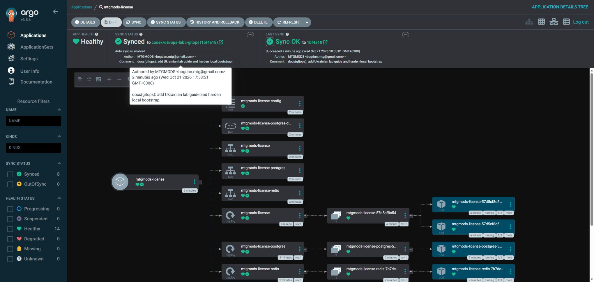
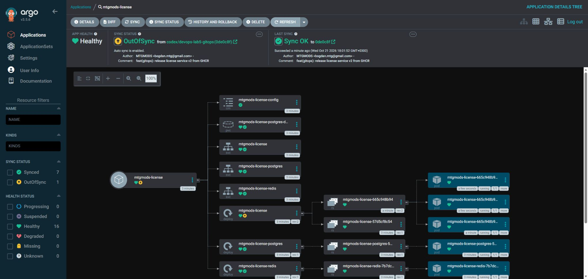
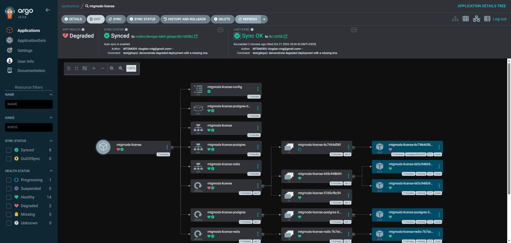
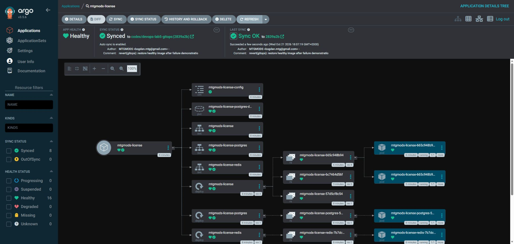

# DevOps №5 — фактична перевірка 21.10.2026

## Середовище

Окремий Minikube-профіль `mtgmods-devops5`, Docker driver, containerd,
Kubernetes 1.35.1, 4 CPU / 6 GiB RAM. Argo CD і CLI — 3.5.6.
CLI перевірено за SHA256 офіційного `cli_checksums.txt`.
Production-репозиторій та production сервіси під час роботи не змінювалися.

До злиття PR №14 прогін виконувався на гілці `codex/devops-lab5-gitops`:
і root, і дочірній Application читали саме цю гілку. У кінцевих маніфестах
встановлено `main`; після merge кореневий Application застосовується з
`bootstrap/root.yaml`, щоб більше не залежати від тестової гілки.

## 1. Bootstrap і перший sync

- Застосовано лише root Application; дочірній створено Argo CD з Git.
- Namespace застосунку — `mtgmods-gitops`.
- Секрети згенеровано локально, чарт не рендерить Secret.
- Початковий admin-пароль змінено; `argocd-initial-admin-secret` видалено.
- UI доступний лише через loopback: `http://127.0.0.1:18090`.
- API, PostgreSQL і Redis запущені; два API pods Ready.
- Підтверджено `Synced / Healthy`, `helm list -n mtgmods-gitops` порожній.



## 2. Оновлення через Git

Початковий образ `sha-805ca0af230d9ece135982527f3c69ba6ca231b0` замінено на
`sha-07f44c2e07c73ad805d978dedb06ca231f3f8850`. Новий образ опублікував
успішний push pipeline [39620556367](https://github.com/MTGMODS/labs-license-management-platform/actions/runs/39620556367).
Його manifest доступний у GHCR без автентифікації:
`sha256:717ab319f373b2668683f811df873c1908aad955623799ea45b828fbe5312157`.

Commit `0de0c8f` змінив image tag та `config.appVersion`. Після push і
refresh Argo CD сам виконав rollout; ручні `helm upgrade` / `kubectl set image`
не використовувались. `/health` змінив `version` із `devops-lab5-v1` на
`devops-lab5-v2`, стан повернувся до `Synced / Healthy`.

## 3. Дрейф без selfHeal та з selfHeal

На ревізії `0de0c8f` із `selfHeal: false` виконано `kubectl scale ... --replicas=3`.
Отримано **3/3 Ready**, `OutOfSync / Healthy`; Argo CD не повертав дві репліки.



Commit `44c925c` увімкнув `selfHeal: true` у дочірнього Application.
Root підхопив зміну з Git, після чого Argo CD повернув **3 → 2** репліки.
Повторний ручний scale до трьох теж автоматично повернувся до двох,
без ручного scale назад. Перевірено `true Synced Healthy` та **2/2 Ready**.

## 4. Synced, але Degraded

Commit `8c1d35b` задав неіснуючий `image.tag: nonexistent-devops-lab5`.
DB-init із окремим стабільним тегом успішно завершився, тож неправильний
образ застосовано саме до API Deployment. Новий pod отримав `ErrImagePull` /
`ImagePullBackOff`, а Deployment — `ProgressDeadlineExceeded`.

Фактичний стан Argo CD:

```json
{"sync":"Synced","health":"Degraded","phase":"Succeeded","message":"successfully synced (all tasks run)"}
```

Це не суперечність: маніфести застосовано, але новий образ не запускається.
Старі два Ready pods залишилися доступними завдяки `maxUnavailable: 0`.



## 5. Відкат через git revert

Виконано `git revert --no-commit 8c1d35bac34b3ca2625be72ffbed022b79affe9f`,
після чого створено commit `2839a2b` із поясненням revert і зроблено push.
Argo CD автоматично повернув робочий image tag і `Synced / Healthy`.
API має **2/2 Ready**, `/health` відповідає `UP`, версія `devops-lab5-v2`.

Історія `argocd app history mtgmods-license`, час Europe/Kyiv:

```text
ID  DATE                        REVISION
0   2026-10-21 18:00:01 +0300   1bf4a18   initial sync
1   2026-10-21 18:01:52 +0300   0de0c8f   release v2
2   2026-10-21 18:03:15 +0300   44c925c   selfHeal
3   2026-10-21 18:04:45 +0300   8c1d35b   missing image, Synced / Degraded
4   2026-10-21 18:07:19 +0300   2839a2b   git revert, Healthy
```

UID PVC до та після всіх експериментів однаковий:
`9682412b-d356-49e1-9a43-c482db5adf0b`, стан `Bound`.
PostgreSQL і його сховище для відкату не видалялися.



## 6. Автоматичні перевірки

- Повний Python-набір: **176 passed**.
- `tests/test_gitops.py`: п'ять перевірок реального Helm rendering та CI gates.
- Ruff нового тестового файлу: успішно.
- `helm lint`: успішно для minikube, dev і prod профілів.
- PowerShell parser: bootstrap не має синтаксичних помилок.
- Client-side Kubernetes dry-run GitOps-маніфестів: успішно.
- Початкові push і PR pipelines: успішно. Після фінального commit потрібно
  також дочекатися перевірок саме останнього SHA перед merge.

Підготовка й команди повторення всіх пунктів:
[DevOps №5](../devops-lab5.md).
