# Виміряні метрики лабораторної №5

Warm-up не входить у ці перцентилі. RPS враховує час завершення запитів після ступеня.

## read_one_cached

| VUs | RPS | Avg ms | p50 ms | p95 ms | p99 ms | Помилки % |
|---:|---:|---:|---:|---:|---:|---:|
| 1 | 30.18 | 32.80 | 28.68 | 55.46 | 68.58 | 0.00 |
| 10 | 30.59 | 323.71 | 296.82 | 497.88 | 544.16 | 0.00 |
| 25 | 31.66 | 761.03 | 715.36 | 1224.36 | 1247.38 | 0.00 |
| 50 | 31.42 | 1477.91 | 1496.65 | 1795.06 | 1941.30 | 0.00 |
| 100 | 30.31 | 2832.64 | 3052.43 | 3625.99 | 3642.94 | 0.00 |
| 200 | 31.08 | 4996.21 | 6031.85 | 6461.46 | 6523.81 | 0.00 |

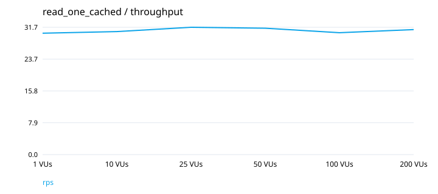
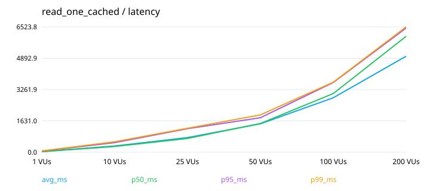

## read_three_cached

| VUs | RPS | Avg ms | p50 ms | p95 ms | p99 ms | Помилки % |
|---:|---:|---:|---:|---:|---:|---:|
| 1 | 32.09 | 30.85 | 27.67 | 50.03 | 61.62 | 0.00 |
| 10 | 81.22 | 120.83 | 101.27 | 247.62 | 367.71 | 0.00 |
| 25 | 80.18 | 304.14 | 273.41 | 549.06 | 671.34 | 0.00 |
| 50 | 73.62 | 648.03 | 607.55 | 1034.71 | 1112.24 | 0.00 |
| 100 | 81.02 | 1135.91 | 1151.90 | 1553.58 | 1741.89 | 0.00 |
| 200 | 79.22 | 2226.05 | 2354.76 | 2846.02 | 2977.08 | 0.00 |

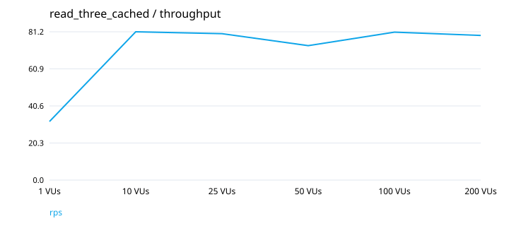
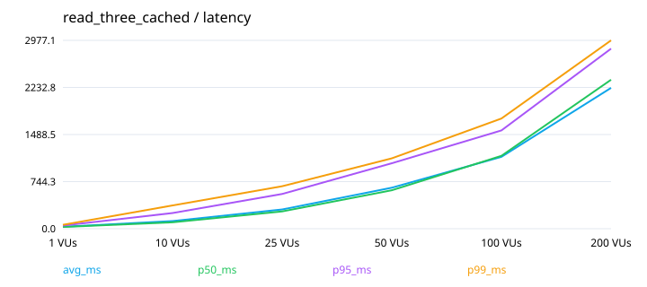
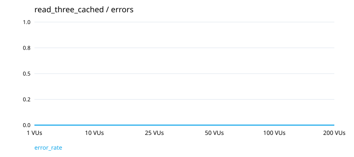

## read_three_uncached

| VUs | RPS | Avg ms | p50 ms | p95 ms | p99 ms | Помилки % |
|---:|---:|---:|---:|---:|---:|---:|
| 1 | 10.99 | 90.72 | 79.98 | 136.45 | 169.36 | 0.00 |
| 10 | 30.68 | 319.14 | 285.09 | 553.77 | 844.94 | 0.00 |
| 25 | 29.25 | 827.23 | 743.98 | 1396.72 | 1625.77 | 0.00 |
| 50 | 29.30 | 1600.83 | 1502.68 | 2700.22 | 3097.12 | 0.00 |
| 100 | 30.29 | 2962.92 | 3149.06 | 3840.08 | 4069.84 | 0.00 |
| 200 | 31.49 | 5223.84 | 5908.49 | 6670.57 | 6889.68 | 0.00 |

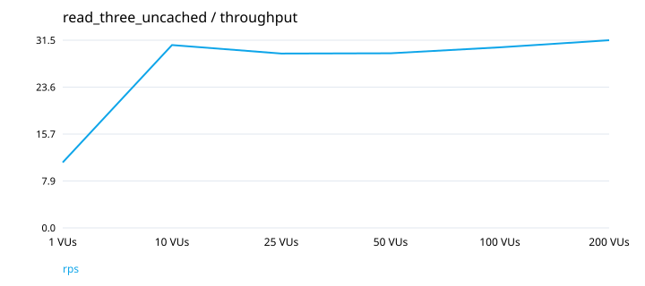
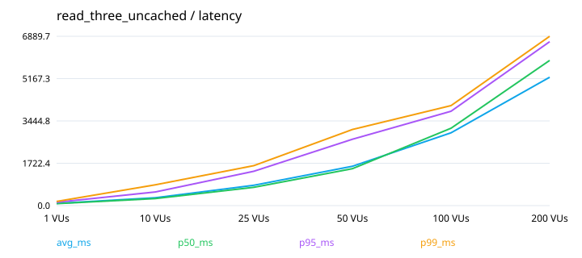
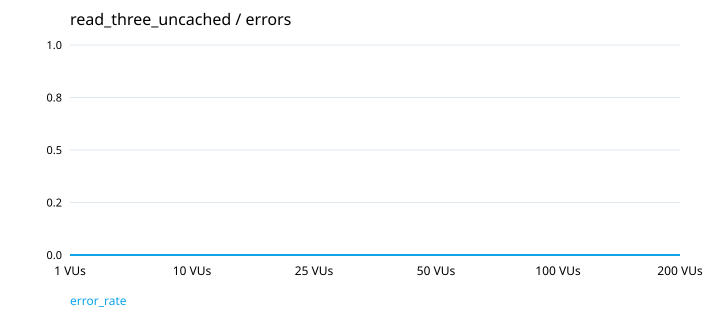

## workflow_three

| VUs | RPS | Avg ms | p50 ms | p95 ms | p99 ms | Помилки % |
|---:|---:|---:|---:|---:|---:|---:|
| 1 | 135.20 | 7.11 | 5.86 | 11.56 | 21.49 | 0.00 |
| 10 | 410.83 | 24.04 | 16.39 | 67.71 | 164.64 | 0.00 |
| 25 | 292.47 | 84.43 | 25.66 | 347.80 | 582.19 | 0.00 |
| 50 | 335.98 | 143.06 | 51.25 | 548.26 | 753.22 | 0.00 |
| 100 | 354.82 | 263.76 | 257.86 | 582.49 | 839.22 | 0.00 |
| 200 | 366.93 | 508.05 | 450.58 | 997.27 | 1604.05 | 0.00 |

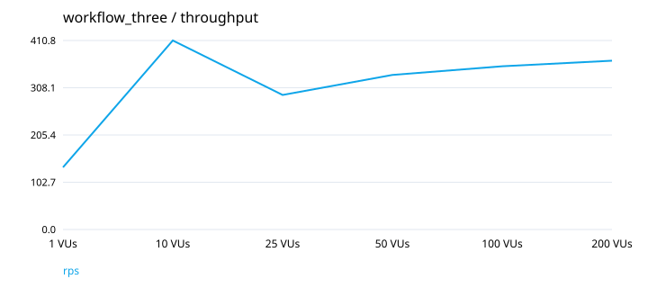
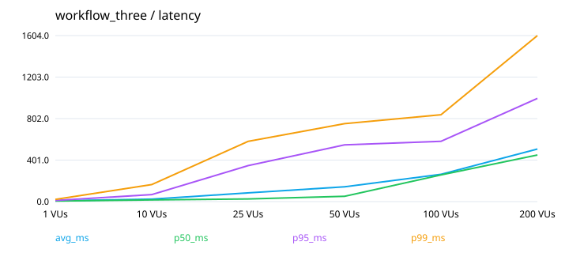
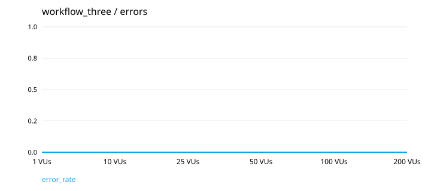

## write_three

| VUs | RPS | Avg ms | p50 ms | p95 ms | p99 ms | Помилки % |
|---:|---:|---:|---:|---:|---:|---:|
| 1 | 154.48 | 6.20 | 5.65 | 9.39 | 15.33 | 0.00 |
| 10 | 567.04 | 17.39 | 13.51 | 36.22 | 92.62 | 0.00 |
| 25 | 507.72 | 48.08 | 10.66 | 147.29 | 345.13 | 0.00 |
| 50 | 553.86 | 89.42 | 48.46 | 266.53 | 412.77 | 0.00 |
| 100 | 473.57 | 202.55 | 185.85 | 521.48 | 724.79 | 0.00 |
| 200 | 489.50 | 402.01 | 377.10 | 834.05 | 1019.21 | 0.00 |

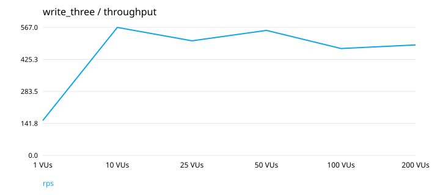
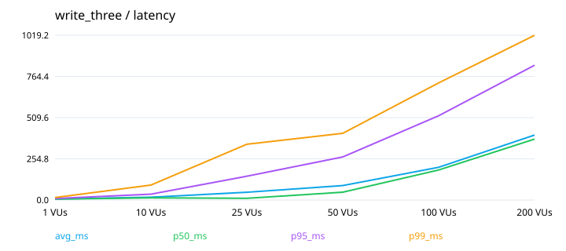
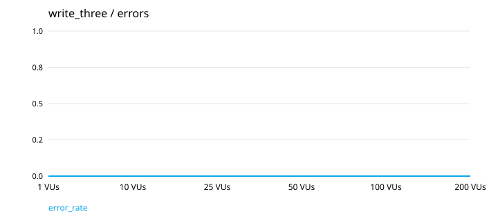

